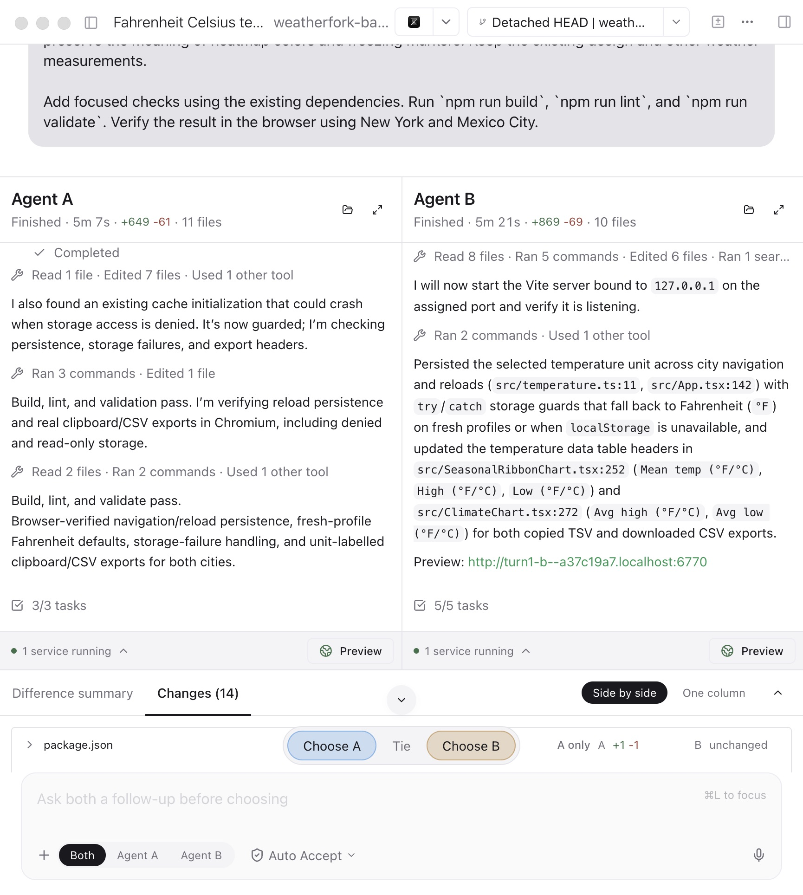
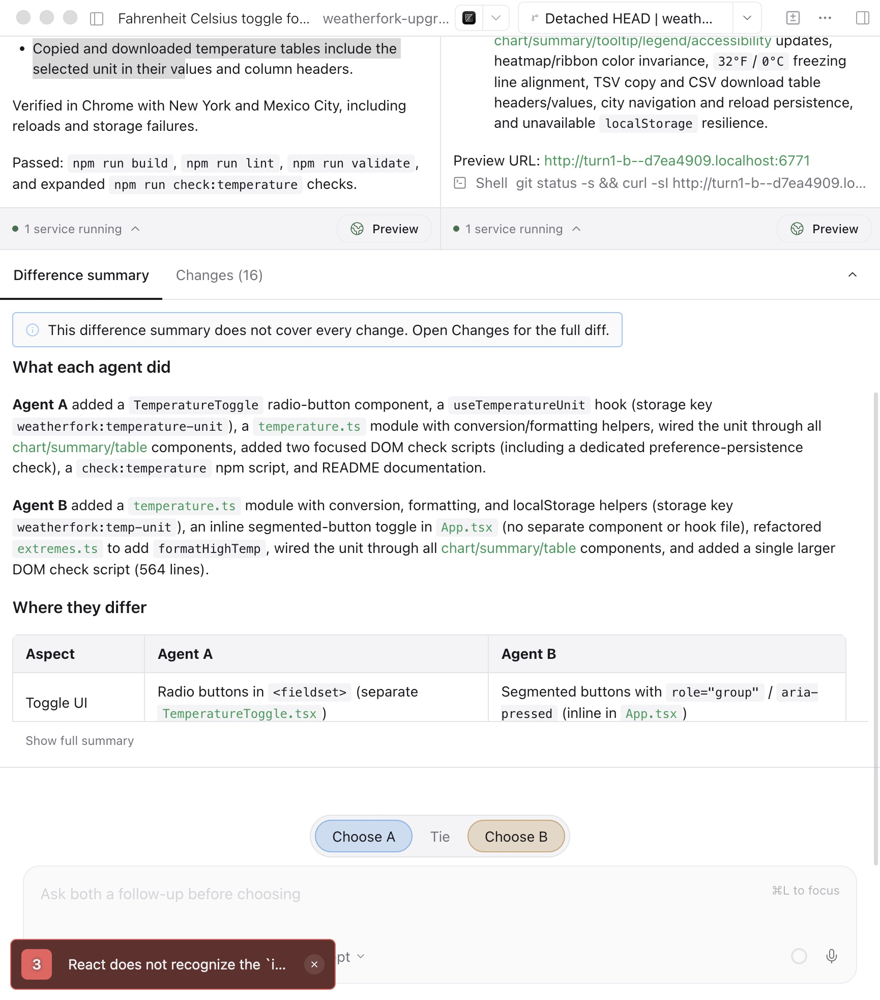

# OpenCode 2.0.32 migration QA

This change layers the OpenCode upgrade on PR #117. The vendored baseline is upstream `v2.0.32` (`843a6c514e606b436a7fe713422ace0a93ad3d61`), running on Bun 1.4.2.

## Technical checks

[Validation output](validation.txt) records targeted checks for native Core execution, authenticated V2 transport, V1 history migration, contestant completion, voting, winner grafting, loser exclusion, and replay into the next battle. It also records root/backend typechecks, lint, formatting, server build, and the compiled desktop engine.

[Transport regression output](transport-fixes.txt) covers the SSE heartbeat lifetime and active-battle environment reconciliation. The shell-environment regression uses actual Core shell execution in concurrent sessions. The final delegation regression fails against the old input schema and passes after the fix: [red](astra-delegation-schema-red.log), [green](astra-delegation-schema-green-final.log), 11 tests / 55 assertions. [Compiled smoke](astra-delegation-compiled-smoke.json) confirms health version 2.0.32 and the updated tool description in the executable.

## Paid delegation replay

[Calls and public child results](delegation-replay.json) record two successful native Core/Arena child executions through the production Astra profile and normal BYOK backend:

- Captured original delegation: preserve agent, full task prompt, model and background mode; correct only `sessionID: "ses_invalid"` to the documented new-session value `""`. The child completed 77 tools and identified the live preview port/browser tooling without editing application files or starting services.
- Captured 38-message model context with the updated schema and `subagent` explicitly selected: Astra generated `sessionID: ""` itself; its child completed 25 tools and returned a read-only audit.

An unconstrained context replay selected other tools. It is not counted as a delegation success. Invalid nonempty resume IDs remain errors. Parent execution-harness acknowledgments were synthetic; child model requests and tools were real. Child tasks inspected the historical worktree after comparison, rather than restoring every file/service to its earlier state. The final native run used source; the rebuilt binary received a separate health smoke.

## Weatherfork comparison

Three matched pairs: 12 contestant sessions and 24 requested turns including follow-ups, with Astra/Argon side assignments matched between Main and the upgrade. Both exact production profiles retained their reasoning/routing settings in isolated QA configuration. Contestant blinding and production defaults stayed intact. Each battle started from Weatherfork `1bff999eced9c49f2a9b05efc3ae2042a69d147a`, excluding the user's uncommitted changes.

Both Astra implementations completed the temperature and persistence work. Argon had better temperature-surface coverage in the later upgrade runs, but its sparse progress communication remained. Browser checks covered conversion anchors, F-C-F display, stable color meaning, New York/Mexico City navigation, storage failures, and clipboard/CSV units. These are exploratory observations: the first two pairs had unequal output caps; some early Electron observations were missing. All matched comparisons predate the final shell-environment and delegation-schema fixes. No fourth matched pair was run.

Actual macOS Electron screens before the final votes:

| Main                           | OpenCode 2.0                           |
| ------------------------------ | -------------------------------------- |
|  |  |

The upgrade screenshot retains the observed React development warning. Its initial renderer readiness timeout and relaunch were recorded; they are not represented as uninterrupted initial UI coverage. Timestamped transport samples did not show duplicate delivery within matched generations; unmatched captures were left unclassified.

## Coverage limits and redaction

macOS Electron, browser QA, source engine, and compiled macOS engine were exercised. Windows/Linux packaging and a complete regression suite were not run. The repository prohibits running the full local suite. Raw outputs below retain test behavior while replacing personal checkout/home/temp paths with placeholders. Full transcripts and capture databases remain local; credentials and private reasoning are excluded from public evidence.
