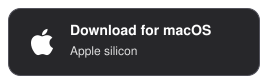
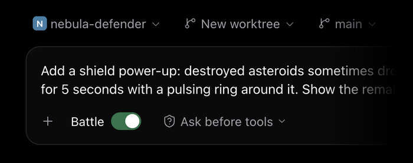
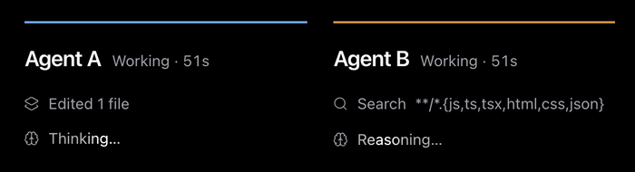
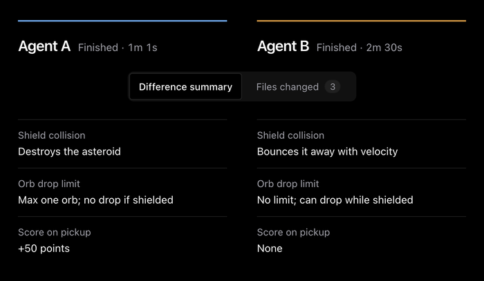
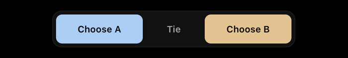
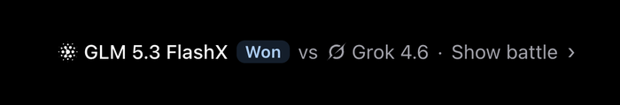

<p align="center">
  
</p>

<h1 align="center">Agent Duel</h1>

<p align="center">A desktop app for head-to-head coding agent battles, with single-agent mode and free inference. Pick the winning agent and continue from its work.</p>

<p align="center">
  <a href="https://github.com/bottomless/agent-duel/releases/download/v0.4.0-beta.26/Agent-Duel-0.4.0-beta.26-arm64.dmg"></a>
  <a href="https://github.com/bottomless/agent-duel/releases/download/v0.4.0-beta.26/Agent-Duel-Setup-0.4.0-beta.26-x64.exe"></a>
</p>

<p align="center">
  Free to use. Inference included.
  <br>
  <sub>v0.4.0-beta.26 · <a href="https://github.com/bottomless/agent-duel/releases/tag/v0.4.0-beta.26">Release notes</a></sub>
</p>

## How a battle works

**1. One prompt.** You describe a coding task once.

<p align="center">
  
</p>

**2. Two models, drawn at random.** Both get the same prompt, tools and system prompt, and each works in its own copy of your repo. Sides are random, so A and B carry no meaning.

<p align="center">
  
</p>

**3. Compare the results.** Read the Difference summary, open Files changed for the code, and try each version with Preview.

<p align="center">
  
</p>

**4. Vote.** Keep one result or call a tie, before either model is named.

<p align="center">
  
</p>

**5. Both models named.** You see which model wrote each result, and the one you kept is applied to your repo.

<p align="center">
  
</p>

## Demo

https://github.com/user-attachments/assets/6413a6f6-b8d6-47cb-bbd3-e1667b2cdf15

The shipped product is the Electron desktop app. `packages/app` can run in a
browser during development and automated QA, but there is no hosted browser
product.

## Current models

<a href="https://agentduel.com/leaderboard">
  <picture>
    <source media="(prefers-color-scheme: dark)" srcset="https://agentduel.com/readme/current-models-dark.svg">
    
  </picture>
</a>

See [leaderboard](https://agentduel.com/leaderboard) for model performance

## Architecture

Execution stays on your machine:

```text
Electron UI -> local daemon -> local Arena runtime -> local repositories and agents
                                       |
                                       |-> Agent Duel cloud -> OpenRouter (official download)
                                       `-> OpenRouter (your key in a BYOK build)
```

The UI WebSocket terminates at the local daemon. The packaged desktop
application contains the daemon, renderer, and compiled Arena runtime.

The official download uses Agent Duel's cloud service for sign-in, model
assignments, and model calls. The cloud service is closed source and maintained
outside this repository.

Arena history is canonical on the desktop: SQLite records live under
`$PASEO_HOME/arena/arena.sqlite` and artifact bytes under
`$PASEO_HOME/arena/artifacts/sha256/`.

Read [docs/architecture.md](docs/architecture.md) for the complete system design
and [docs/arena.md](docs/arena.md) for the battle.

## Develop locally

Local development requires no sign-in. Battles run on your own OpenRouter key,
and votes are not uploaded.

### Requirements

- macOS or Linux
- Node.js 22 with npm
- Bun 1.3.14
- An OpenRouter API key

Install both package graphs, then start the desktop stack in bring-your-own-key
mode from the repository root:

```bash
npm install
cd arena-backend && bun install && cd ..
npm run dev:desktop -- --byok
```

The launcher prepares an isolated checkout-local environment and starts the
local daemon, the Electron-flavoured Expo server, and Electron. It reports
`[dev] healthy:` when the stack is ready. Paste your OpenRouter key in Settings;
battles run on that key.

### Troubleshooting

- If a dependency is missing, run `npm install` at the root and `bun install` in
  `arena-backend`.
- If a port is busy, leave the daemon, Expo, and debugger ports unset where
  supported so the launcher can choose free ports.
- Inspect `.dev/paseo-home/daemon.log` for daemon failures.

See [docs/development.md](docs/development.md) for worktrees, multiple instances,
Playwright/Chrome testing, logs, and focused validation commands.
To package the desktop app with hosted sign-in or your own OpenRouter key, see
[the desktop build instructions](docs/deployment.md#build-the-macos-desktop-application).

## Repository map

- `arena-backend/packages/opencode` — local Arena engine compiled into desktop.
- `arena-backend/packages/arena-service` — battle routes (model draw, model proxy,
  comparison) shared with the hosted service.
- `packages/desktop` — Electron shell, daemon supervision, and packaging.
- `packages/app` — shared renderer; browser execution is a development/QA surface.
- `packages/server` — local daemon, WebSocket API, and agent lifecycle.
- `packages/protocol` and `packages/client` — local wire protocol and client SDK.
- `packages/cli` — local daemon CLI bundled with desktop.
- `packages/relay` — inherited optional remote-access transport.

## Common commands

```bash
npm run dev:desktop -- --byok        # Complete local desktop stack on your OpenRouter key
npm run dev                          # Local daemon only
npm run dev:app                      # Browser-based development/QA renderer
npm run build:server                 # Build daemon and shared packages
npm run typecheck
npm run lint
npm run format
```

## Contributing

See [CONTRIBUTING.md](CONTRIBUTING.md). Questions and help: [SUPPORT.md](SUPPORT.md).
Security: [SECURITY.md](SECURITY.md). Everyone taking part follows the
[Code of Conduct](CODE_OF_CONDUCT.md).

## Built on

Agent Duel is a fork of [Paseo](https://github.com/getpaseo/paseo), which provides the desktop app, local daemon, and agent integrations. Its bundled battle engine is built on a vendored fork of [OpenCode](https://github.com/anomalyco/opencode).

Agent Duel adds blinded coding-agent battles, side-by-side comparison, and voting that carries the selected result into your chat and repository.

## License

- The combined application is AGPL-3.0-or-later. See [LICENSE](LICENSE).
- New original contributions are Apache-2.0. See [LICENSE-APACHE](LICENSE-APACHE)
  and the [contribution licensing policy](CONTRIBUTING.md#license).
- Inherited OpenCode material in `arena-backend/` retains its MIT license and
  notices. See [arena-backend/LICENSE](arena-backend/LICENSE).
- Existing and third-party material retains its applicable licenses.

We plan to move the application to Apache-2.0 after rebasing onto Apache-licensed Paseo and clearing any remaining AGPL-only material.

[NOTICE](NOTICE) has the full licensing and attribution details. The hosted Agent Duel service is not part
of this repository.
