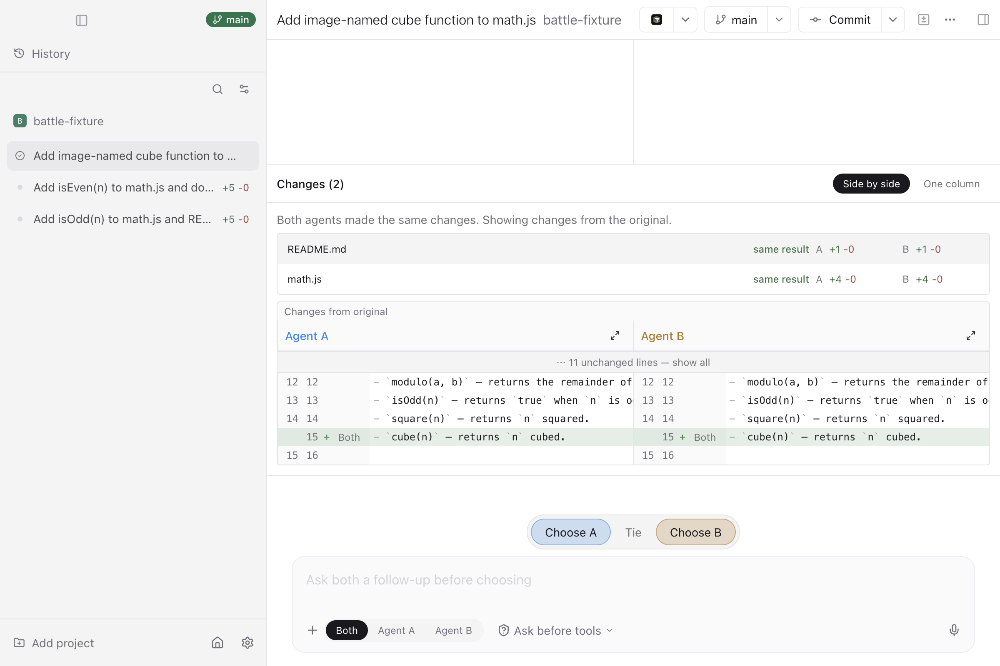

<p align="center">
  
</p>

<h1 align="center">Agent Duel</h1>

<p align="center">A desktop app for head-to-head coding agent battles, with single-agent mode and free inference. Pick the winning agent and continue from its work.</p>

<p align="center">
  <a href="https://github.com/bottomless/agent-duel/releases/download/v0.4.0-beta.20/Agent-Duel-0.4.0-beta.20-arm64.dmg"></a>
  <br>
  <sub>v0.4.0-beta.20 · <a href="https://github.com/bottomless/agent-duel/releases/tag/v0.4.0-beta.20">Release notes</a><br>Free to use. Inference included.</sub>
</p>

## Demo

<p align="center">
  
</p>

## Contents

- [Current models](#current-models)
- [Installation](#installation)
- [Development](#develop-locally)
- [Contributing](#contributing-and-support)

## Current models

The hosted version draws from:

- <picture><source media="(prefers-color-scheme: dark)" srcset="docs/images/models/anthropic-dark.svg"></picture> [Claude Fable 5.2](https://agentduel.com/leaderboard/models/anthropic/claude-fable-5.2)
- <picture><source media="(prefers-color-scheme: dark)" srcset="docs/images/models/anthropic-dark.svg"></picture> [Claude Opus 5.5](https://agentduel.com/leaderboard/models/anthropic/claude-opus-5.5)
- <picture><source media="(prefers-color-scheme: dark)" srcset="docs/images/models/openai-dark.svg"></picture> [GPT-6 Astra](https://agentduel.com/leaderboard/models/openai/gpt-6-astra)
- <picture><source media="(prefers-color-scheme: dark)" srcset="docs/images/models/openai-dark.svg"></picture> [GPT-6.1 Sol](https://agentduel.com/leaderboard/models/openai/gpt-6.1-sol)
- <picture><source media="(prefers-color-scheme: dark)" srcset="docs/images/models/moonshot-dark.svg"></picture> [Kimi K3.1 Pro](https://agentduel.com/leaderboard/models/moonshotai/kimi-k3.1-pro)
- <picture><source media="(prefers-color-scheme: dark)" srcset="docs/images/models/meta-dark.svg"></picture> [Muse Wonder](https://agentduel.com/leaderboard/models/meta/muse-wonder)
- <picture><source media="(prefers-color-scheme: dark)" srcset="docs/images/models/xai-dark.svg"></picture> [Grok 4.7](https://agentduel.com/leaderboard/models/x-ai/grok-4.7)
- <picture><source media="(prefers-color-scheme: dark)" srcset="docs/images/models/qwen-dark.svg"></picture> [Qwen 3.8 Max](https://agentduel.com/leaderboard/models/qwen/qwen3.8-max-0902)
- <picture><source media="(prefers-color-scheme: dark)" srcset="docs/images/models/google-dark.svg"></picture> [Gemini Carbon](https://agentduel.com/leaderboard/models/google/gemini-4-carbon)
- <picture><source media="(prefers-color-scheme: dark)" srcset="docs/images/models/deepseek-dark.svg"></picture> [DeepSeek V4.1 Flash 1017](https://agentduel.com/leaderboard/models/deepseek/deepseek-v4.1-flash-1017)
- <picture><source media="(prefers-color-scheme: dark)" srcset="docs/images/models/xiaomi-dark.svg"></picture> [MiMo-V2.6 Flash](https://agentduel.com/leaderboard/models/xiaomi/mimo-v2.6-flash)

## Installation

[Download Agent Duel v0.4.0-beta.20 for macOS (Apple silicon)](https://github.com/bottomless/agent-duel/releases/download/v0.4.0-beta.20/Agent-Duel-0.4.0-beta.20-arm64.dmg), install Agent Duel, and sign in.

The official download provides hosted model access. Agent execution and Git
worktrees run locally; model requests use Agent Duel's cloud service and OpenRouter.

## Official download and BYOK

|              | Official download          | Source build        |
| ------------ | -------------------------- | ------------------- |
| Sign-in      | Required                   | Not required        |
| Model access | Agent Duel hosted service  | Your OpenRouter key |
| Execution    | Local                      | Local               |
| Votes        | Uploaded to hosted service | Not uploaded        |

The hosted service is maintained separately and is not included in this repository.

## Develop locally

Requirements: macOS or Linux, Node.js 22 with npm, Bun 1.3.14, and an OpenRouter API key.

```bash
npm install
cd arena-backend && bun install && cd ..
npm run dev:desktop -- --byok
```

Wait for `[dev] healthy:`, then paste your OpenRouter key in Settings.

Read the [development guide](docs/development.md) for troubleshooting, worktrees,
logs, and validation commands, or the [desktop build guide](docs/deployment.md) to
package the app.

### Documentation

- [Battle lifecycle](docs/arena.md) — blinding, voting, and canonical history.
- [Architecture](docs/architecture.md) — desktop, daemon, engine, and cloud boundaries.
- [Documentation index](docs/README.md) — all guides and subsystem references.

<details>
<summary>Repository map and common commands</summary>

- `packages/desktop` — Electron shell and packaging.
- `packages/app` — desktop renderer and browser QA harness.
- `packages/server` — local daemon and agent lifecycle.
- `packages/protocol` and `packages/client` — wire schemas and client SDK.
- `packages/cli` — bundled daemon CLI.
- `packages/relay` — optional remote-access transport.
- `arena-backend/packages/opencode` — local battle engine.
- `arena-backend/packages/arena-service` — shared battle routes.

The root uses npm workspaces. The vendored backend has its own Bun install.

```bash
npm run dev:desktop -- --byok
npm run build:server
npm run typecheck
npm run lint
npm run format
```

</details>

## Contributing and support

Read the [contribution guide](CONTRIBUTING.md) to get started. Report reproducible
bugs in [GitHub Issues](https://github.com/bottomless/agent-duel/issues); see
[Support](SUPPORT.md) for help and [Security](SECURITY.md) for private vulnerability
reports. All participants follow the [Code of Conduct](CODE_OF_CONDUCT.md).

## Built on

Agent Duel is a fork of [Paseo](https://github.com/getpaseo/paseo), with a battle
engine built on a vendored fork of [OpenCode](https://github.com/anomalyco/opencode).

## License

- Combined application: AGPL-3.0-or-later.
- New original contributions: Apache-2.0.
- Inherited OpenCode material: MIT, with its existing notices.
- Existing and third-party material retains its applicable licenses.

See [LICENSE](LICENSE), [LICENSE-APACHE](LICENSE-APACHE),
[arena-backend/LICENSE](arena-backend/LICENSE), the
[contribution licensing policy](CONTRIBUTING.md#license), and [NOTICE](NOTICE) for
the full terms and attribution.

We plan to move the application to Apache-2.0 after rebasing onto Apache-licensed
Paseo and clearing any remaining AGPL-only material. The hosted service is not part
of this repository.
